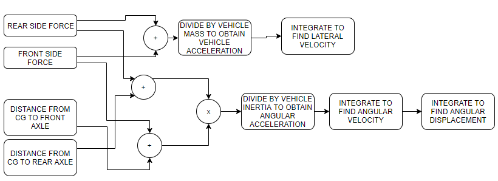
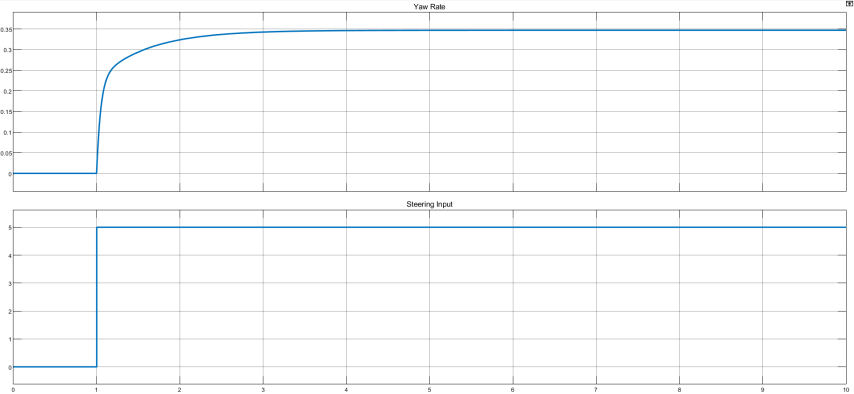
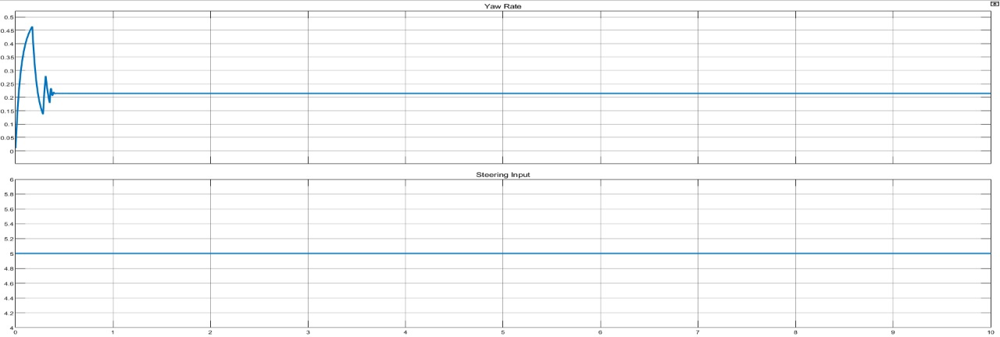

# Vehicle Yaw Stability Control Using Differential Braking

A MATLAB/Simulink model of a passenger car's lateral dynamics with a yaw stability controller that applies differential braking. It was built as the course project for **ME780 Vehicle System Dynamics** at the **University of Waterloo**. The literature review was written in Fall 2021, and the model and final report were completed in January 2023.



## What the model does

The vehicle is represented as a 2-DOF linear bicycle model (lateral velocity and yaw rate) at a constant forward speed. The Simulink model is made of these parts:

- **Equations of motion.** Front and rear lateral tire forces, plus a corrective braking force, are summed and divided by the vehicle mass and yaw inertia. They are then integrated to give lateral velocity, yaw rate and heading.
- **Slip angle calculator.** It computes front and rear tire slip angles from lateral velocity, yaw rate, CG-to-axle distances and the road-wheel steering angle.
- **Tire force calculator.** It uses a linear tire model: lateral force is slip angle times cornering stiffness.
- **Transformation matrix.** A MATLAB Function block rotates the forces from the vehicle frame into the ground frame.
- **Yaw controller.** It compares the ideal turning radius (wheelbase ÷ steering angle) with the actual radius (wheelbase ÷ (steering angle + front and rear slip angles)). A PID controller turns the radius error into a braking force that is fed back into the equations of motion. The force is zero when the vehicle is neither understeering nor oversteering. The gains came from Simulink's PID auto-tuner: Kp = −765.56, Ki = −781 534, Kd = −0.0269, N = 5836.6.

The model was tested with a 5° step steer and a slalom steering input, each with and without the controller. The uncontrolled step responses were cross-checked against the textbook *Theory of Ground Vehicles*.

## Results

The figures below are from the January 2023 report. They are yaw rate responses to a 5° step steer.

| Without controller | With PID differential-braking controller |
|---|---|
|  |  |

The full set of results is in [`docs/Project_Report.pdf`](docs/Project_Report.pdf), including slip angles, slalom maneuvers and the speed-versus-radius transient.

## Running it

You need MATLAB and Simulink. The model was saved in **R2021b**, and later releases will open it. From the repository folder, run:

```matlab
run_model
```

This loads `VHD_parameters.m` into the workspace and simulates `VHDModel.slx` for 30 s. The results show in the model's Scope blocks.

## Repository layout

| Path | Contents |
|---|---|
| `VHDModel.slx` | Simulink model |
| `VHD_parameters.m` | Vehicle parameters loaded before simulation |
| `Vehicle_Parameters.xlsx` | Parameter worksheet used while building the model |
| `run_model.m` | Loads the parameters and runs the model |
| `Pabsalib_Project.prj`, `resources/` | MATLAB project file |
| `docs/Project_Report.pdf` | Final report (January 2023) |
| `docs/Assignment1_Literature_Review.docx` | Assignment 1 literature review, Fall 2021 (its title page says Fall 2020 by mistake) |
| `references.md` | Works cited in the report |

## Changes since the original submission

The submitted files are preserved unchanged at the tag [`v2023-original`](../../tree/v2023-original). After that tag, these changes were made:

- **CG-to-axle distances corrected in `VHD_parameters.m`.** The original values of 2.71 m and 1.81 m add up to 4.52 m, which doesn't match the 2.6 m wheelbase. They are now 1.56 m and 1.04 m, taken from `Vehicle_Parameters.xlsx`. This keeps the same 60/40 split along a 2.6 m wheelbase. The report's figures were produced before this correction, and the PID gains were tuned before it, so re-running the model will not exactly reproduce them and the controller may need re-tuning.
- **Cornering stiffness units clarified.** The comments now say kN/rad; the model multiplies the tire-force output by 1000.
- **Other changes.** `run_model.m` and this README were added, the report and literature review were moved into `docs/`, and Simulink build caches are now ignored.

`Vehicle_Parameters.xlsx` also lists a 1360 kg mass and a 15:1 steering ratio. The script keeps its original 1600 kg and 1:1. The model takes the road-wheel angle directly as its input, so the steering ratio has no effect.

## Limitations

- A linear bicycle model at constant speed can't capture load transfer, tire saturation or a separate force for each wheel. A 4-wheel, 3-DOF model is the natural next step, and it would let the braking force go to a specific wheel instead of a lumped corrective force.
- The PID gains come from the auto-tuner alone. Other tuning methods weren't compared.

## Literature

The project began with a review of research on electronic stability control and direct yaw-moment control through differential braking. The Fall 2021 review is in `docs/`, and the works cited in the report are listed in [`references.md`](references.md).

---

© Philopatear Salib. All rights reserved. This repository is published for portfolio viewing; no license to reuse it is granted.
